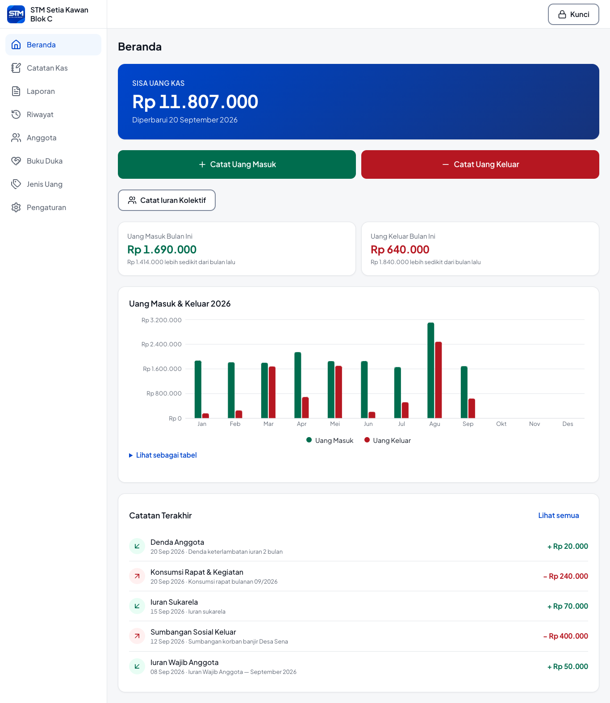
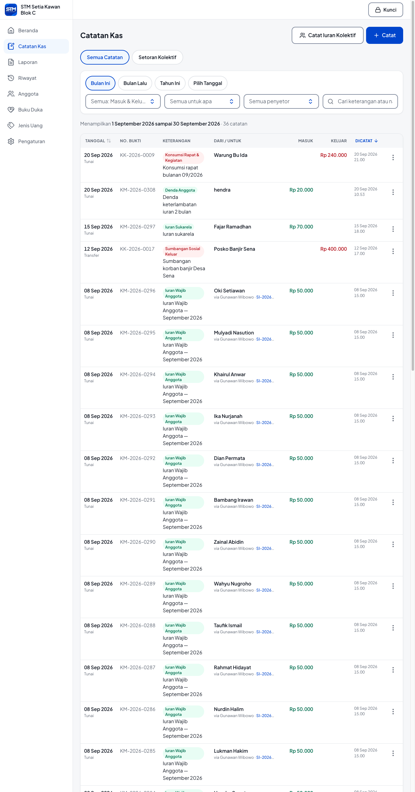
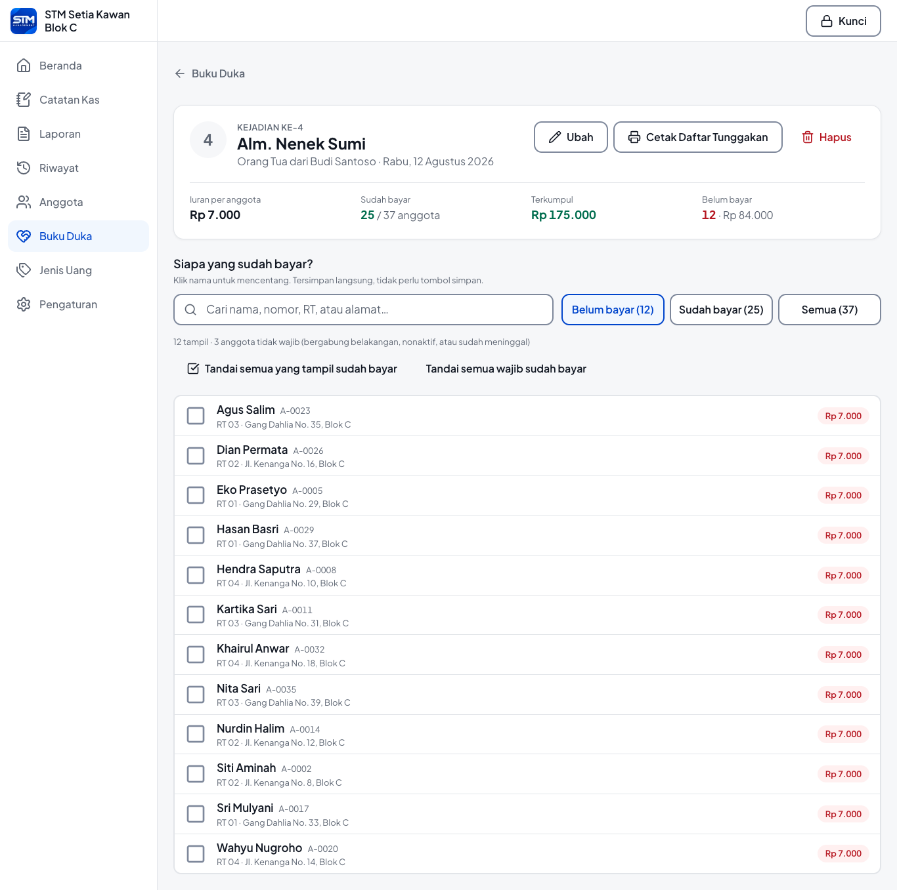
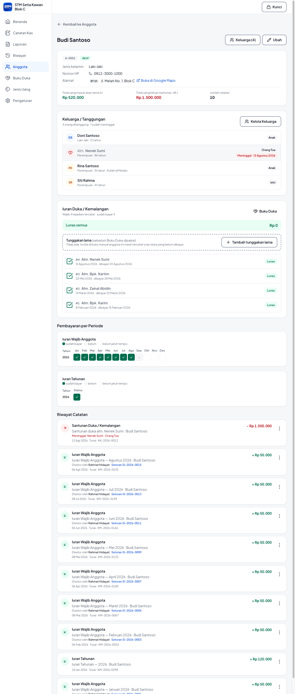
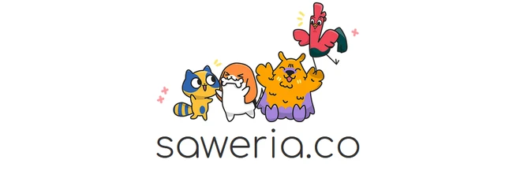

# Aplikasi Kas STM

Aplikasi pembukuan kas untuk **STM (Serikat Tolong Menolong)** — perkumpulan warga yang
mengumpulkan iuran anggota dan menyalurkannya sebagai santunan duka.

Bentuknya **aplikasi desktop Windows** (installer `.exe` dan versi portable) yang dipakai
**satu orang**: bendahara, di satu komputer. Seluruh data tersimpan lokal dalam satu berkas
SQLite — **tanpa internet, tanpa server, tanpa akun**. Masih berjalan di **Windows 7 SP1**
(32-bit maupun 64-bit), karena komputer di balai warga sering seumur itu.

**Gratis dan terbuka. Tidak untuk diperjualbelikan. Dikembangkan bersama-sama.**
Dibuat untuk pengurus perkumpulan warga yang selama ini mencatat kas di buku tulis — silakan
dipakai, dipelajari, dan dikembangkan, tanpa biaya sepeser pun.


> Versi saat ini: **0.2.0** · Lihat seluruh tampilan di
> **[docs/tangkapan-layar/](docs/tangkapan-layar/README.md)** (42 tangkapan layar dengan data contoh).

---

## Daftar isi

- [Fitur](#fitur)
- [Tangkapan layar](#tangkapan-layar)
- [Kebutuhan sistem](#kebutuhan-sistem)
- [Clone & jalankan untuk pengembangan](#clone--jalankan-untuk-pengembangan)
- [Perintah yang tersedia](#perintah-yang-tersedia)
- [Database & migrasi](#database--migrasi)
- [Membuat `.exe` untuk Windows](#membuat-exe-untuk-windows)
- [Struktur proyek](#struktur-proyek)
- [Teknologi](#teknologi)
- [Dokumentasi](#dokumentasi)
- [Ikut mengembangkan](#ikut-mengembangkan)
- [Dukung pengembangan](#dukung-pengembangan)
- [Lisensi & ketentuan pemakaian](#lisensi--ketentuan-pemakaian)

---

## Fitur

### Pengaturan awal & keamanan
- Wizard tiga langkah saat pertama dibuka: nama STM → nama bendahara → **PIN 6 angka**.
- **Kode pemulihan** dicetak/disalin sekali di awal, untuk membuka aplikasi bila PIN lupa.
- Layar kunci dengan papan angka besar; kunci otomatis setelah 15 menit tanpa aktivitas.
- Tema terang/gelap/ikut sistem.

### Catatan kas
- Catat **Uang Masuk / Uang Keluar** dengan nomor bukti otomatis (`KM-2026-0001`, `KK-2026-0001`).
- Form sengaja disederhanakan untuk pengguna lanjut usia: kalender langsung terlihat (tanpa
  dropdown), kolom isian bertepi tebal, tombol Simpan/Batal lengket di bawah, dan pilihan
  (jenis, anggota, penyetor) memakai **modal pencarian** yang jelas terpisah dari latar.
- **Periode pembayaran** per catatan (bulanan/tahunan) + peringatan bila anggota yang sama
  dicatat dua kali untuk periode yang sama.
- **Penyetor**: siapa yang membawa uangnya ke bendahara (tim pengutip atau anggota lain).
- **Foto bukti** (maks. 5 MB) tersimpan di folder data.
- Daftar berbentuk **tabel**: tanggal, nomor bukti, keterangan, dari/untuk, masuk, keluar,
  waktu dicatat, subtotal halaman; urut bawaan **waktu dicatat** (bisa diurutkan per tanggal),
  25 baris per halaman dengan pilihan 10/25/50/100.
- Hapus bersifat **lunak**: catatan bisa dikembalikan dari Riwayat.

### Setoran kolektif (iuran banyak anggota sekaligus)
- Satu setoran dari pengutip bisa memuat **banyak anggota × banyak jenis** sekaligus.
- Pilih anggota lewat modal pencarian dengan centang banyak; yang sudah bayar periode itu
  ditandai otomatis.
- Baris berperiode bisa membayar beberapa bulan sekaligus (otomatis menjadi beberapa catatan).
- Kartu **"tanpa nama"** untuk uang gabungan yang tidak dirinci per orang.
- **Tanda terima cetak** untuk pengutip.

### Buku Duka (iuran kemalangan)
- Daftar **kejadian meninggal**; tarif iuran **dikunci per kejadian** — kejadian lama tetap
  Rp 5.000 walau tarif sekarang Rp 7.000.
- Centang siapa yang sudah bayar langsung di daftar (tersimpan seketika), dengan penyaring
  Belum/Sudah, pencarian, dan "tandai semua".
- Yang wajib membayar dihitung otomatis dari data anggota (tanggal bergabung, nonaktif,
  sudah meninggal).
- **Tunggakan lama** per kelompok tarif untuk masa sebelum aplikasi dipakai
  (mis. "6 kejadian × Rp 5.000" + "10 kejadian × Rp 7.000"), bisa dicicil pembayarannya.
- Cetak **daftar tunggakan** berkolom paraf untuk dibawa pengutip.

### Anggota
- Daftar berhalaman dengan pencarian langsung ke database (siap untuk ribuan anggota) dan
  penyaring: aktif, nonaktif, meninggal, tim pengutip, **nunggak duka**, serta **per RT**.
- Data: nomor anggota, jenis kelamin, HP, alamat + **titik peta**, RT, tanggal bergabung.
- **Keluarga/tanggungan** dengan hubungan, jenis kelamin (Istri otomatis perempuan, Suami
  otomatis laki-laki), umur, status meninggal; tanggungan bisa **dipecah menjadi anggota sendiri**.
- **Data RT** (CRUD) lengkap dengan jumlah anggota per RT.
- Detail anggota: ringkasan uang, keluarga, status iuran duka, **matriks pembayaran per periode**,
  dan riwayat catatannya.
- **Peta semua anggota** satu layar penuh dengan cluster dan pencarian (ubin OpenStreetMap
  lewat proxy lokal yang menyimpan cache, jadi tetap tampil offline untuk area yang pernah dibuka).

### Jenis uang
- 23 jenis bawaan (iuran wajib, iuran duka, santunan, konsumsi rapat, dll.) + bisa menambah sendiri.
- Per jenis: nominal bawaan (bisa **dikunci**), periode (bebas/sekali/bulanan/tahunan),
  penanda "menandai meninggal", dan **biaya kutip %**.
- **Biaya kutip otomatis**: untuk jenis tertentu, sekian persen dicatat sendiri sebagai uang
  keluar bagian pengutip. Uang masuk tetap dicatat **bruto** — mis. masuk Rp 100.000 dan
  keluar Rp 10.000 — dan catatan otomatis itu mengikuti induknya saat diubah/dihapus.

### Laporan & cetak
- Ringkasan: sisa kas awal, uang masuk, uang keluar, selisih, sisa kas akhir, jumlah catatan.
- Rincian per jenis (masuk & keluar), rekap per penyetor, grafik bulanan.
- Penyaring periode (harian s.d. tahunan atau rentang bebas), jenis, cara bayar, penyetor.
- Cetak/PDF: **Laporan Ringkas**, **Buku Kas** (saldo berjalan), **Berita Acara Pemeriksaan Kas**,
  tanda terima setoran, daftar tunggakan duka.

### Riwayat & cadangan
- Setiap perubahan (buat/ubah/hapus/kembalikan) tercatat dengan data lama & baru.
- **Cadangan otomatis** setiap aplikasi dibuka (disimpan 10 berkas terakhir), cadangan manual
  ke lokasi pilihan, dan pulihkan dari berkas `.db` dengan ringkasan isi sebelum konfirmasi.
- **Penguncian periode**: catatan sebelum tanggal tertentu tidak bisa diubah lagi.

---

## Tangkapan layar

| | |
|---|---|
|  |  |
| **Beranda** — sisa kas, grafik, catatan terakhir | **Catatan Kas** — tabel, penyaring, ringkasan |
|  |  |
| **Buku Duka** — centang pembayaran per kejadian | **Detail anggota** — keluarga, iuran duka, riwayat |

Selengkapnya (42 gambar, termasuk alur pengaturan awal, laporan, cetak, peta, mode gelap, dan
tampilan layar sempit): **[docs/tangkapan-layar/](docs/tangkapan-layar/README.md)**.

---

## Kebutuhan sistem

**Untuk pengguna aplikasi (`.exe`)**
- Windows 7 SP1 / 8 / 10 / 11, 32-bit atau 64-bit.
- ± 400 MB ruang disk. Tidak perlu Node.js, tidak perlu internet
  (internet hanya dipakai bila ingin melihat peta alamat).

**Untuk pengembangan**
- **Node.js 20** (wajib — lihat [`docs/05`](docs/05-DUKUNGAN-WINDOWS-7.md); `npm install` akan
  gagal di Node 22/24 karena `better-sqlite3` 9.6.0 tidak punya prebuild untuk versi itu).
- Git. Untuk membuat `.exe` dari macOS/Linux: koneksi internet saat pertama kali
  (mengunduh biner Electron dan prebuild native) — **tanpa Wine**.

---

## Clone & jalankan untuk pengembangan

```bash
# 1. Clone
git clone git@github.com:alpandi15/stm-management-app.git
cd stm-management-app

# 2. Pakai Node 20 (berkas .nvmrc sudah disediakan)
nvm use          # atau: nvm install 20 && nvm use 20

# 3. Pasang dependensi
npm install

# 4. Jalankan di browser — paling cepat untuk membangun UI
npm run dev      # buka http://localhost:3000
```

Saat pertama dibuka, aplikasi menampilkan **wizard pengaturan awal** (nama STM, bendahara, PIN).
Database dan foto bukti dibuat otomatis di folder `data/` pada akar proyek (sudah di-`gitignore`).

Ingin mencobanya di dalam jendela Electron seperti yang dipakai pengguna:

```bash
npm run dev:electron   # menjalankan `next dev` lalu membuka jendela Electron ke sana
```

> **Catatan:** sebagian terminal menyetel `ELECTRON_RUN_AS_NODE=1` secara global sehingga
> Electron menolak jalan sebagai aplikasi. Bila itu terjadi, jalankan dengan
> `env -u ELECTRON_RUN_AS_NODE npm run dev:electron`.

### Memulai dari data kosong

Hapus folder `data/`, lalu buka lagi aplikasinya — wizard pengaturan awal muncul kembali.

### Mengisi data contoh (untuk demo / tangkapan layar)

`scripts/data-demo.js` mengisi 40 anggota, 4 RT, kejadian duka, dan 300+ catatan;
`scripts/tangkap-layar.js` menjalankan seluruh alur aplikasi dan menyimpan tangkapan layarnya
ke `docs/tangkapan-layar/`.

---

## Perintah yang tersedia

| Perintah | Kegunaan |
| --- | --- |
| `npm run dev` | Next.js di browser (`http://localhost:3000`) |
| `npm run dev:electron` | Next dev + jendela Electron |
| `npm run lint` | ESLint |
| `npm run typecheck` | TypeScript (`tsc --noEmit`) |
| `npm test` | Uji unit (`node --test` lewat tsx) — rumus uang, tanggal, aturan duka, biaya kutip |
| `npm run db:generate` | Membuat berkas migrasi dari perubahan skema Drizzle |
| `npm run db:migrate` | Menerapkan migrasi ke database |
| `npm run db:studio` | Melihat isi database lewat Drizzle Studio |
| `npm run build:app` | Build Next standalone + salin `static`/`public`/`drizzle` |
| `npm run native:win` | Unduh prebuild `better-sqlite3` untuk Windows ia32 + x64 (sekali saja) |
| `npm run dist:win` | **Membuat `.exe`**: `build:app` + `native:win` + electron-builder |

Sebelum mengirim perubahan, jalankan ketiganya:

```bash
npm run lint && npm run typecheck && npm test
```

---

## Database & migrasi

- Satu berkas SQLite (`stm.db`) lewat **better-sqlite3** + **Drizzle ORM**.
  - Pengembangan: `data/stm.db` di akar proyek.
  - Aplikasi terpasang: `%APPDATA%\Aplikasi Kas STM\data\stm.db`.
- Semua uang disimpan sebagai `INTEGER` **rupiah penuh** — tanpa desimal, tanpa `float`.
- **Migrasi berjalan otomatis** setiap aplikasi dibuka, jadi pengguna cukup memasang versi baru
  di atas versi lama; datanya ikut.
- Mengubah skema:

  ```bash
  # 1. ubah src/server/db/schema.ts
  npm run db:generate -- --name nama_perubahan   # menulis drizzle/00xx_nama_perubahan.sql
  npm run db:migrate                             # menerapkannya ke data/stm.db
  ```

---

## Membuat `.exe` untuk Windows

```bash
nvm use
npm run dist:win
```

Hasilnya di folder `release/`:

| Berkas | Keterangan |
| --- | --- |
| `AplikasiKasSTM-Setup-0.2.0.exe` | **Installer** — memilih sendiri 32/64-bit saat dipasang. Ini yang dibagikan ke bendahara. |
| `AplikasiKasSTM-Portable-0.2.0-ia32.exe` | Portable 32-bit (jalan di semua Windows) |
| `AplikasiKasSTM-Portable-0.2.0-x64.exe` | Portable 64-bit |
| `AplikasiKasSTM-Portable-0.2.0.exe` | Portable gabungan kedua arsitektur |

Beberapa hal yang perlu diketahui:

- **Bisa dibuat dari macOS/Linux** tanpa Wine. `npm run native:win` mengunduh prebuild
  `better-sqlite3` ber-ABI Electron 110, lalu electron-builder menaruhnya per arsitektur.
- **Jangan menjalankan `electron-rebuild`** di repo ini: `node_modules` sengaja tetap ber-ABI
  Node 20 agar `npm run dev` dan `npm test` tetap jalan.
- **Menaikkan versi**: `npm version 0.3.0 --no-git-tag-version`, lalu build ulang. Versi tampil
  di Pengaturan › Tentang dan menjadi nama berkas `.exe`.
- **SmartScreen**: installer tidak ditandatangani secara digital, jadi Windows menampilkan
  *"Windows protected your PC"* saat pertama dijalankan → **More info → Run anyway**.
- Memasang versi baru di atas versi lama **tidak menghapus data**; mencopot aplikasi juga tidak.
- Bila aplikasi gagal terbuka di komputer pengguna, catatan galatnya ada di
  `%APPDATA%\Aplikasi Kas STM\data\aplikasi.log`.

---

## Struktur proyek

```
src/
  app/                  # Halaman Next.js (App Router)
    (app)/              #   kerangka ber-sidebar: beranda, catatan, laporan, riwayat,
                        #   anggota, duka, jenis, pengaturan
    (auth)/             #   layar kunci PIN
    setup/              #   wizard pengaturan awal
    cetak/              #   halaman cetak A4 (laporan, buku kas, tanda terima, tunggakan)
    api/                #   route handler: foto bukti, unduh cadangan, proxy ubin peta
  components/           # Komponen UI (ui/ bergaya shadcn, ditulis sendiri)
  lib/                  # Fungsi murni: rupiah, tanggal, aturan duka, biaya kutip, validasi Zod
  server/               # SATU-SATUNYA tempat akses database
    actions/            #   Server Actions (semua perubahan data)
    queries/            #   kueri baca
    services/           #   aturan bisnis + log + nomor bukti
    db/                 #   skema Drizzle, migrasi otomatis, seed jenis bawaan
drizzle/                # Berkas migrasi SQL
electron/               # Proses utama, preload, layar muat, polyfill Node 16
scripts/                # Build standalone, unduh native, dev Electron, data demo, tangkapan layar
docs/                   # Dokumentasi + tangkapan layar
```

---

## Teknologi

| | |
| --- | --- |
| Kerangka | Next.js 14.2 (App Router) + React 18.3 + TypeScript, `output: 'standalone'` |
| Database | SQLite (better-sqlite3 9.6.0) + Drizzle ORM & Drizzle Kit |
| Tampilan | Tailwind CSS 4, komponen bergaya shadcn/ui di atas Radix + cva, lucide-react |
| Form & validasi | React Hook Form + Zod |
| Lain-lain | Recharts (grafik), cmdk (pencarian), react-day-picker (kalender), Leaflet + markercluster (peta), sonner (notifikasi), jose (sesi), bcryptjs (PIN) |
| Desktop | Electron 22.3.27 + electron-builder (nsis & portable, ia32 + x64) |

Versi Next, React, Electron, dan better-sqlite3 **dikunci** demi dukungan Windows 7 —
alasannya ada di [`docs/05`](docs/05-DUKUNGAN-WINDOWS-7.md). Jangan menaikkannya tanpa membaca itu.

---

## Dokumentasi

| Berkas | Isi |
| --- | --- |
| [`CLAUDE.md`](CLAUDE.md) | Aturan kerja di repo ini + daftar jebakan yang sudah diketahui |
| [`docs/01-PRODUK-DAN-UI.md`](docs/01-PRODUK-DAN-UI.md) | Pengguna, prinsip UX, sistem desain, tampilan tiap halaman |
| [`docs/02-SPEC-TEKNIS.md`](docs/02-SPEC-TEKNIS.md) | Skema database, login PIN, aturan bisnis, rumus laporan, cetak, cadangan |
| [`docs/03-ELECTRON-BUILD.md`](docs/03-ELECTRON-BUILD.md) | Menggabungkan Next.js ke Electron dan membuat `.exe` |
| [`docs/04-RENCANA-BUILD.md`](docs/04-RENCANA-BUILD.md) | Urutan pengerjaan beserta bukti uji tiap fitur |
| [`docs/05-DUKUNGAN-WINDOWS-7.md`](docs/05-DUKUNGAN-WINDOWS-7.md) | Versi yang dikunci, polyfill Node 16, cara mengujinya |

---

## Ikut mengembangkan

Proyek ini dibuka supaya tidak berhenti di satu orang. Setiap STM punya kebiasaan yang
berbeda — tarif iuran, cara pengutipan, bentuk laporan yang diminta saat rapat — dan justru
perbedaan itu yang membuat aplikasinya makin matang. Kontribusi apa pun diterima dengan
senang hati:

| Anda bisa | Caranya |
| --- | --- |
| **Melaporkan masalah** | Buka *Issue*: ceritakan langkahnya, apa yang terjadi, dan apa yang Anda harapkan. Bila aplikasi gagal terbuka, lampirkan `%APPDATA%\Aplikasi Kas STM\data\aplikasi.log`. |
| **Mengusulkan fitur** | Buka *Issue* berisi kasus nyata di perkumpulan Anda — bukan sekadar nama fitur. Keputusan desain di sini hampir selalu berangkat dari cerita pengurus di lapangan. |
| **Mengirim perubahan kode** | *Fork* → buat cabang → `npm run lint && npm run typecheck && npm test` → *Pull Request* yang menjelaskan **kenapa**, bukan hanya apa. |
| **Membantu tanpa menulis kode** | Menguji di Windows sungguhan (terutama Windows 7), merapikan dokumentasi, menyusun panduan pemakaian untuk pengurus, atau menerjemahkan istilah agar lebih mudah dipahami. |

Sebelum menyentuh kode, baca dulu [`CLAUDE.md`](CLAUDE.md) dan [`docs/02-SPEC-TEKNIS.md`](docs/02-SPEC-TEKNIS.md).
Dua hal yang dipegang teguh di repo ini:

1. **Ini aplikasi keuangan.** Kesalahan angka tidak terlihat sampai tutup buku, jadi setiap
   aturan uang ditulis sebagai fungsi murni di `src/lib/` **beserta pengujiannya**.
2. **Penggunanya bendahara berusia 50 tahun ke atas.** Tambahan fitur tidak boleh membuat
   layar jadi ramai; bila sebuah pilihan bisa dihitung sendiri oleh aplikasi, hitung sendiri.

Punya pertanyaan atau ingin mengerjakan sesuatu yang besar? Buka *Issue* lebih dulu supaya
arahnya bisa dibicarakan sebelum Anda menghabiskan waktu.

---

## Dukung pengembangan

Aplikasi ini gratis dan dikembangkan di waktu luang. Kalau bermanfaat untuk STM atau
perkumpulan Anda, dukungan sekecil apa pun sangat membantu untuk pengembangan berikutnya 🙏

<p>
  <a href="https://teer.id/alpandi15_">
    
  </a>
  &nbsp;&nbsp;
  <a href="https://saweria.co/alpandi15">
    
  </a>
</p>

- **Trakteer** — [teer.id/alpandi15_](https://teer.id/alpandi15_)
- **Saweria** — [saweria.co/alpandi15](https://saweria.co/alpandi15)

Cara lain yang juga berarti: laporkan bug lewat Issues, ceritakan kebutuhan STM Anda, atau
bagikan aplikasinya ke pengurus perkumpulan lain.

---

## Lisensi & ketentuan pemakaian

**Gratis untuk dipakai siapa saja.** STM, arisan, paguyuban, pengurus RT/RW, atau perkumpulan
mana pun boleh memasang dan memakai aplikasi ini tanpa biaya, tanpa izin khusus, dan tanpa
batas jumlah anggota. Kode sumbernya terbuka untuk dipelajari dan dimodifikasi sesuai kebutuhan
perkumpulan masing-masing.

**Dilarang diperjualbelikan.** Aplikasi ini — baik berkas `.exe`, kode sumbernya, maupun
turunannya — tidak boleh dijual, disewakan, dijadikan produk berlangganan, atau dipaketkan ke
dalam layanan berbayar. Memungut biaya kepada pengurus atau warga untuk mendapatkan aplikasi
ini bertentangan dengan tujuan dibuatnya. Mengganti nama dan logonya lalu menjualnya sebagai
produk sendiri juga tidak diperbolehkan.

Yang **boleh**: membagikan `.exe` secara cuma-cuma, memasangnya di banyak komputer, mengubah
kodenya untuk kebutuhan perkumpulan sendiri, dan membagikan hasil modifikasinya selama tetap
gratis serta tetap menyebut sumbernya. Menerima upah atas jasa pemasangan atau pelatihan masih
wajar — yang dilarang adalah menjual aplikasinya.

Yang **tidak**: menjual, memasang kunci berbayar, atau menghapus keterangan sumber.

Ringkasnya: **ambil, pakai, kembangkan, bagikan — jangan dijual.** Untuk pemakaian di luar
ketentuan ini, hubungi pemilik repositori lebih dulu.

Aplikasi diberikan apa adanya, tanpa jaminan. Pembukuan tetap tanggung jawab bendahara —
biasakan menyimpan cadangan berkala (menu Pengaturan › Cadangan).
